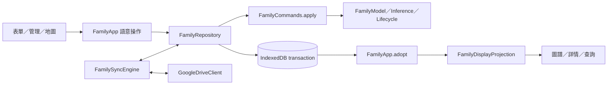

# FamilyTree 應用程式與驗證架構

## 執行與資料邊界

正式網站是 `src/` 建置出的靜態 HTML、CSS、JavaScript，以 GitHub Pages 發布。使用者資料以 IndexedDB 為 primary store；Google Drive 是選用的 remote replica。`dev/server.cjs` 的 REST API 是本機開發及既有測試的 adapter，不是正式後端。`fixtures/` 的資料只供測試，發布包由 check-release 拒絕夾帶。

## 模組責任

| 模組 | 責任與契約 |
|---|---|
| FamilySchema、FamilyModel | schema v2／v3、來源資料、參照、排行、循環、領域圖譜及關係驗證；公開 Model API 保留有效性檢查 |
| FamilyInference、RelationshipEvidence | 可重建的親屬推論及其來源證據；推論不能冒充使用者直接記錄 |
| FamilyCommands | 純語意命令，供瀏覽器與開發 API 共用；完成 schema 檢查、mutation 與推論正規化 |
| FamilyRepository | 儲存模式選擇、IndexedDB transaction、expectedVersion、防重試重複、十筆 undo、匯入前／schema 備份、sync dirty、裝置重置與分頁事件 |
| FamilyApp | 目前 snapshot 與 graph；經 repository 成功後採用狀態，再發出 familyappchange；不直接執行 HTTP 或 IndexedDB 操作 |
| FamilyDisplayProjection | 顯示代別與位置關係，將領域圖轉為顯示用圖；不寫回來源族譜 |
| family-tree-layout／diagram／viewport | 分別計算邏輯配置、DOM／SVG 量測與線路、縮放／移動／語意密度；輸出共用場景及繪圖模組 |
| member-form／member-tools／management | 表單、草稿、共用搜尋下拉、排行與合併；版本衝突保留輸入，欄位提示及焦點以 P-04～P-06 驗收 |
| FamilySyncEngine、GoogleDriveClient、google-drive-sync | 分別處理同步版本決策、Drive I/O、OAuth／排程／狀態 UI；不以遠端儲存取代本機 transaction |
| FamilyLocation、member-locations、member-map | 定位規則與隱私、可暫停且以 Web Locks 協調的定位工作、地圖呈現；外部請求只傳查詢地名，不傳姓名及關係 |

## 一次新增的有效性與提交

正式靜態 UI 保留原生／欄位驗證與錯誤呈現，完整領域檢查由共用命令與 repository 負責。本機 HTTP adapter 尚未傳遞完整欄位錯誤上下文，因此保留開發模式的 UI 領域預檢，以維持既有錯誤定位。來源資料在 transaction 中先核對 expectedVersion，Commands 驗證目前資料、產生候選並正規化推論；repository 完整驗證候選後，才在同一 readwrite transaction 寫入資料、歷史、備份及 dirty。transaction 成功後才採用 snapshot 與建置顯示圖。

讀取既有 IndexedDB 時，舊資料遷移的入口先檢查 envelope。正常讀取及命令邊界仍驗證領域資料，避免同一次操作在 transaction 之前先重建一次同一份舊圖。新增命令的中間候選不在私有 helper 先建圖，後續 completeKinship 及提交檢查仍完整執行。沒有使用跨操作的可變物件快取，也沒有將驗證移到寫入之後。

對於新增命令，P-09 的完整建置上限包含資料升級／命令驗證、推論正規化、repository 寫入前檢查及 App 採用。編輯、合併或其他流程可能因公開 Model API 的契約有不同次數，不能將新增的數字當作所有命令的上限。

## UI 更新、焦點與可選效果

畫布以 familyappchange 取得新的顯示圖。重繪會替換人物 DOM，因此保存畫布內控制項的 personId／planId／evidenceKey；只有焦點確實丟失時才恢復，目標消失回到命名畫布，不搶走表單或 picker 焦點。表單的靜態提示與動態錯誤描述分開，單一 modal 內的 polite live region 播報失焦錯誤。

API 退路、最低支援目標、CI 與實機驗收見 [browser-support.md](browser-support.md)。正式 runtime 不依賴 npm；Playwright 是固定版本的開發依賴。地圖 vendor 套件另在 `dev/map-runtime/` 固定版本，日常 build 不重新下載。

## 建置與驗證

`dev/site-source.cjs` 展開 HTML includes 及儲存模式；`dev/build.cjs` 輸出 dist；`dev/check-release.cjs` 檢查資源與資料界線。Validate FamilyTree 是 PR／push 與發布共用的 gate，Pages 發布不因單一 Node 套件通過就略過瀏覽器測試。

[acceptance_criteria.md](acceptance_criteria.md) 定義 P-01～P-09；project-validation adapter 解析實際測試數與量測，harness config 對接應用套件。harness 自身測試不替代應用驗收。

## Harness 與證據

`.agents/skills/` 與 `harness/skills.json` 提供按需流程；完整方法映射見 [WORKFLOW_COVERAGE.md](WORKFLOW_COVERAGE.md)。Python runner 負責 new／run／compare／lesson 與控制凍結，沒有自動模型編排器。

每次實驗凍結驗收文件、設定、資料生成器、adapter 與測試等 evaluator 檔案；application 原始碼是被評估表面，不列為 evaluator。執行證據包含命令、退出碼、真實測試數、Node／瀏覽器／OS 與 Git／來源身份。變更驗收條件或 evaluator 要新建 experiment；不可覆寫舊證據。

大資料清單不能代替資料本體驗證；Node／OS 的記錄不代表所有硬體相同。量測毫秒數保留環境限制，確定性建置次數才作為本次效能採用門檻。`project_ready` 不代表真實 OAuth、手機實機、所有輔助技術或完整 WCAG 已驗收。
